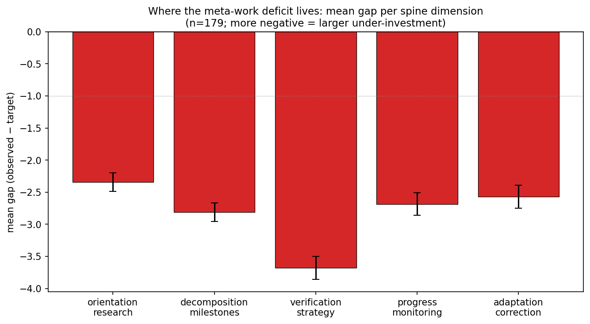
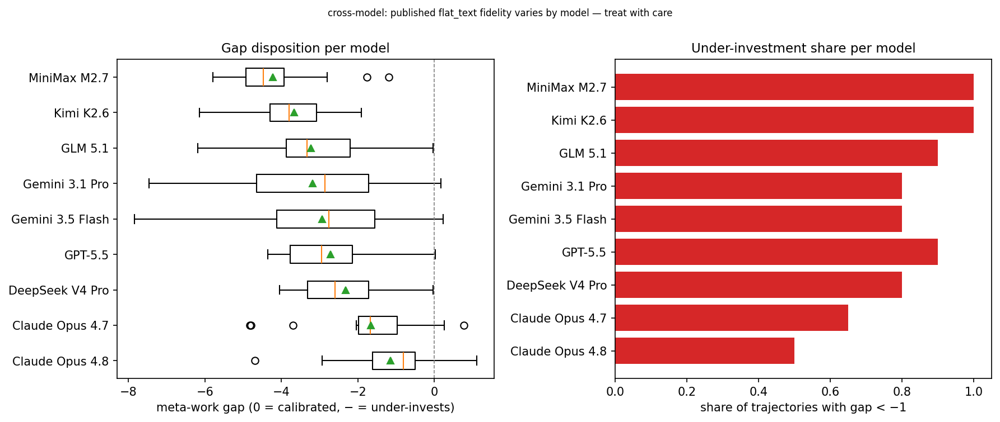
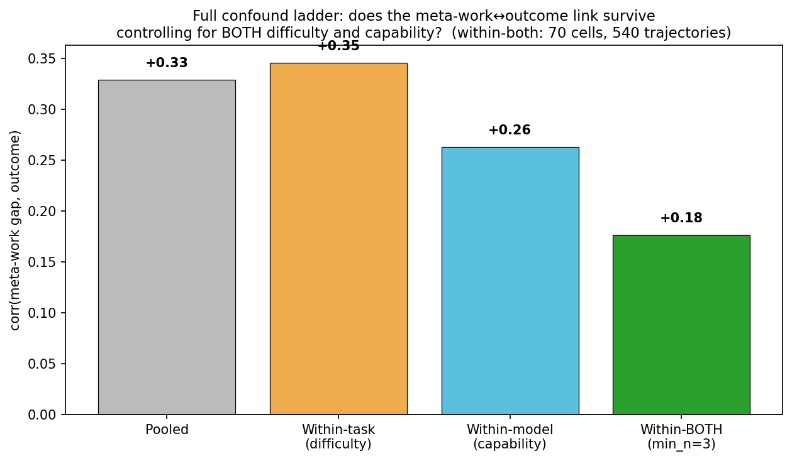

# Meta-Work: the Missing Layer Between LLM Agents and LLM Organizations

Today's LLM agents are remarkably capable at *doing* work — and systematically bad at the **work about the work**: deciding what to understand before acting, how to decompose, how to verify, when to change course. We call this **meta-work**, and we believe it — not raw intelligence — is the binding constraint on long-horizon AI performance. Humanity has already solved this problem once: **organizations** are our technology for doing meta-work at a scale no individual mind can hold. No single human can plan, decompose, verify, and coordinate "make humanity interplanetary" — but a company can. This repository is the empirical ground floor of a research program whose long-term aim is to build that same layer for LLMs: general, scalable **LLM organizations**.

> 📄 **The full vision — theses, argument, and the organization-theory blueprint:**
> [Beyond Superintelligence: Towards General and Scalable LLM Organizations](https://pedrou2000.notion.site/beyond-superintelligence-llm-orgs)

---

## 1. The big picture: from agents to organizations

Collective intelligence has emerged through two known mechanisms. **CI-1** builds intelligence out of non-intelligence — neurons into brains — and is the inspiration behind deep learning. **CI-2** builds *higher* intelligence out of already-intelligent parts — humans into corporations and institutions — and is the mechanism behind every large-scale achievement of our species. For decades, artificial CI-2 was blocked on a prerequisite: you cannot organize agents that aren't smart enough to be organized. LLMs removed that blocker. The base-agent problem is solved; the organizational layer on top of it is now buildable, and it scales along an axis **orthogonal** to raw model capability.

What does an organization actually *add* over its members? Strip away the offices and org charts and what remains is structured, durable, externalized **meta-work**: missions decomposed into roles, plans with milestones, review and verification processes, routines for adapting when reality diverges. The organization is the meta-work, made persistent and shared. That observation sets this project's agenda: if we want LLM organizations, we should first understand — precisely and measurably — how today's LLM agents handle meta-work on their own. The [vision essay](https://pedrou2000.notion.site/beyond-superintelligence-llm-orgs) develops the full argument (possibility, necessity, orthogonality, and the safety case) and the classical blueprints we intend to draw on (Organization-Centered MAS, Beer's Viable System Model, MOISE+, organizational artifacts & stigmergy).

## 2. The problem we study: agents under-invest in meta-work

**Meta-work is "work about the work."** Object-level actions directly transform the deliverable; meta-level actions operate on the *process* — orienting and researching before acting, decomposing into milestones, choosing a verification strategy, monitoring progress, correcting course. Operational test: *an action is meta-work if removing it wouldn't change the deliverable directly, but would change how the rest of the work proceeds.*

Our starting hypothesis is that LLM agents carry a **compulsion to closure**: given a task, they underestimate how much meta-work it warrants and jump to object-level production. Ask an LLM to write a book and it will under-invest in research, drafting, and revision relative to any serious human author — the output may be locally fluent, but the *process* is shallower than the task deserves. Much of recent LLM progress (chain-of-thought, plan-then-act scaffolds, test-time compute) can be read as ad-hoc fixes for exactly this disposition. The payoff of meta-work scales with task horizon: negligible on short tasks, decisive on long ones — which makes this bias precisely the thing standing between today's agents and long-horizon autonomy. (An earlier probe in this repo, `closure/`, measured one narrow slice of the same disposition: whether models voluntarily verify their own answers on math tasks.)

One subtlety shapes everything we measure: the right quantity is **calibration, not volume**. A great engineer writes no design doc for a 20-line fix (doing so would be ceremony) but does deep research, design, and milestone planning for a full-stack build. So we never ask "how much meta-work?" — we ask **how well the agent's meta-work matched what the task demanded**, and we penalize both under-investment (thrash) and over-investment (ceremony). Our headline measure is a **signed gap**: observed meta-work level minus the task-appropriate level, on a 0–10 scale. Zero is calibrated; negative is under-investment.

## 3. How we measure it

There is no off-the-shelf instrument for this, so we built one: a **task-adaptive, two-stage LLM judge**.

- **Stage A — rubric synthesis.** Given only the task specification (what the agent saw at t=0 — never the reference solution or any trajectory), an expert model designs a rubric for *this task*: five fixed "spine" dimensions that make every task comparable (orientation/research, decomposition/milestones, verification strategy, progress monitoring, adaptation/correction) plus a few task-specific dimensions, each with an importance weight and a **target level** — how much an expert practitioner would invest *here*. A trivial task yields a lean rubric; a hard one yields demanding targets with headroom above "adequate."
- **Stage B — trajectory scoring.** One independent judge per dimension explores the agent's raw trajectory with read-only tools and grades the *observed* level, citing step-level evidence. Judges are blind to model identity and task outcome, and never see the targets they're graded against.
- **Aggregate.** Weighted signed gap per trajectory, plus the per-dimension profile.

Before trusting the instrument we **measured our own ruler**: a nested variance study (10 rubrics × 10 rescorings × 2 trajectories) decomposed the judge's run-to-run noise into its two stages. Scoring is tight; the dominant noise is rubric synthesis re-drawing the bar — so for any comparison across conditions we pin a single rubric per task, which removes that noise source entirely. Knowing the noise floor (σ ≈ 0.55 on the gap) is also what lets us say which findings below are far outside it.

## 4. What we've found

**Under-investment is near-universal.** Scoring one trajectory from every frontier model on every task of a long-horizon software benchmark (9 models × 20 tasks, [SWE-Marathon](https://swe-marathon.vercel.app/)): mean gap **−2.8**, with **96% of trajectories under-investing** and 82% by more than a full point. Every model under-invests; stronger models are closer to calibrated (Claude Opus 4.8 at −1.15) and weaker ones further (−4.2), but none reaches zero. The largest deficit, in every model, is **verification** — agents skimp on checking their work more than on any other meta-work faculty.





**Better-calibrated meta-work goes with better outcomes — and the link survives the controls that usually kill such claims.** The obvious worry: maybe "easy tasks make agents look organized *and* produce passing solutions" (difficulty confound), or "capable models both organize better and solve better" (capability confound). We test this with a *confound ladder*: re-computing the gap↔outcome correlation within tasks, within models, and finally **within each (task, model) cell** — comparing only trajectories of the same model on the same task, which removes both confounds at once. On 600 trajectories (4 models × 20 tasks, 5–10 runs per cell):

| control | r |
|---|---|
| pooled | +0.33 |
| within-task (difficulty removed) | +0.35 |
| within-model (capability removed) | +0.26 |
| **within-both** | **+0.18** (p ≈ 3×10⁻⁵) |



This result is worth trusting partly because of how we got here: **our first-generation judge's effect collapsed to zero under exactly this control** — the apparent meta-work effect was pure capability confound. We discarded it, rebuilt the instrument from first principles, and re-ran the test. The new effect attenuates under full control but does not collapse, holds in 60% of cells individually, and holds within every model separately.

**Stated plainly, the limits:** the effect is correlational (nothing here proves that *adding* meta-work causes better outcomes); the within-cell effect size is modest (r ≈ +0.18 observed, ≈ +0.27 after correcting for measured judge noise); and the underlying public corpus preserves different models' reasoning text unevenly, so *cross-model rankings* are suggestive rather than definitive. The within-cell result — the one that carries the causal-adjacent weight — is robust to that artifact by construction.

## 5. Where this goes

The arc of the program: **measure** the meta-work deficit (this repo, done and ongoing) → **intervene**, testing whether content-free nudges and scaffolds can close the gap and whether closing it improves outcomes — turning the correlation above into cause → **organize**, building the structural layer where meta-work stops being a per-agent disposition and becomes an explicit, durable, shared artifact: roles, plans, verification processes, routines. That last step is the [LLM-organizations vision](https://pedrou2000.notion.site/beyond-superintelligence-llm-orgs) this project exists to serve — organizations as the technology that lets bounded agents do unbounded meta-work.

---

## 6. Repository guide

Two research lines share generic infrastructure in `common/`:

- **`metawork/`** — the main line: generate agent trajectories on SWE-Marathon tasks via a local [Harbor](https://github.com/RishiDesai/harbor) harness, score them with the meta-work judge, analyze.
- **`closure/`** — the earlier math probe of self-verification behaviour (compulsion-to-closure, one axis).

```
src/
├── common/      shared infra: model registry (Bedrock), concurrency, tracing
├── closure/     math verify-probe: judge, sweep, analysis
└── metawork/
    ├── judges/
    │   ├── v1_fixed/     frozen first-generation judge (fixed checklist)
    │   └── v2_adaptive/  the task-adaptive two-stage judge (rubric / score / aggregate)
    ├── harbor/      our own trajectory generation + batch scoring
    ├── published/   the published SWE-Marathon corpus path (harvest + scoring)
    └── viz/         local web app: browse trajectories + their judgements

scripts/
├── metawork/
│   ├── run_and_judge.sh            generate → judge, end to end, one command
│   ├── trajectories/               run_trial.sh (generate), viz.py (browse)
│   ├── judge/v2_adaptive/          score_trajectories.py, synth_rubric.py
│   │   └── experiments/            per-experiment runners + plots
│   └── judge/v1_fixed/             frozen v1 pipeline
└── closure/                        run_sweep.py, analyze.py

results/metawork/judged/v2_adaptive/experiments/   each experiment self-contained:
    variance/          judge reliability study        (README + data + plots)
    published_grid/    9×20 under-investment study    (README + data + plots)
    published_within4/ the within-(task,model) test   (data + plots)
```

Each experiment folder has its own README with design, results, and reproduction commands.

### Setup

Requires Python ≥ 3.12 and [`uv`](https://docs.astral.sh/uv/); Docker only for *generating* new trajectories.

```bash
uv sync

# all model calls route through Bedrock (agent under test, verifiers, judges)
export AWS_BEARER_TOKEN_BEDROCK=...
export CLAUDE_CODE_USE_BEDROCK=1
export AWS_REGION=us-east-1
```

To generate trajectories, Harbor and SWE-Marathon are vendored under `vendor/` (gitignored) at pinned commits with our patches — see [`vendor-patches/README.md`](vendor-patches/README.md).

### Common commands

```bash
# end to end: generate one trajectory and judge its meta-work
scripts/metawork/run_and_judge.sh my_job --task excel-clone

# judge existing trajectories (one MetaworkScore per trajectory, + inspection tree)
python scripts/metawork/judge/v2_adaptive/score_trajectories.py --job my_job

# browse trajectories + judgements in the visualizer
python scripts/metawork/trajectories/viz.py --host 0.0.0.0    # → http://localhost:8010

# inspect what rubric the judge synthesizes for a task
python scripts/metawork/judge/v2_adaptive/synth_rubric.py --task excel-clone
```

The judge is **blind by construction**: model identity is scrubbed from trajectories, outcome metadata is joined back only after judging, and Stage-B scorers never see the targets. Fine print (scoring gotchas, harness parity notes) lives in the experiment READMEs and `vendor-patches/`.
